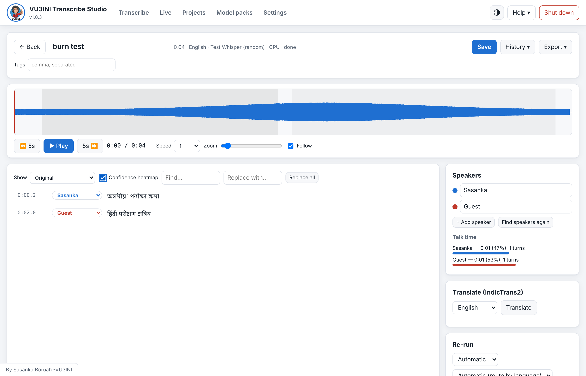
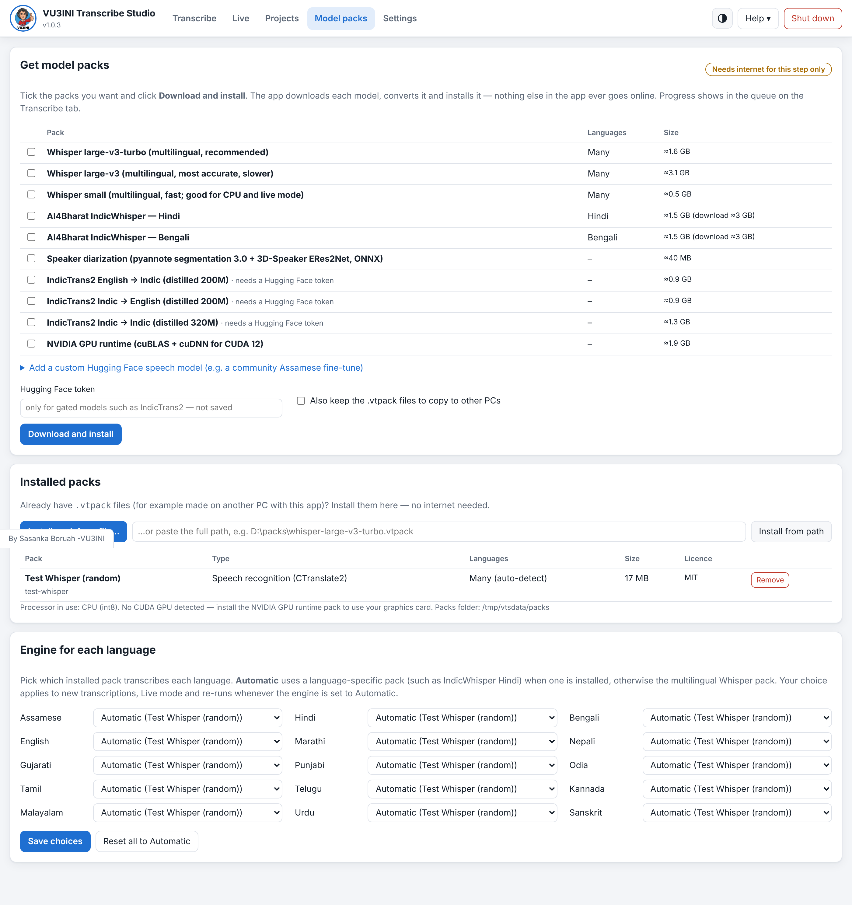
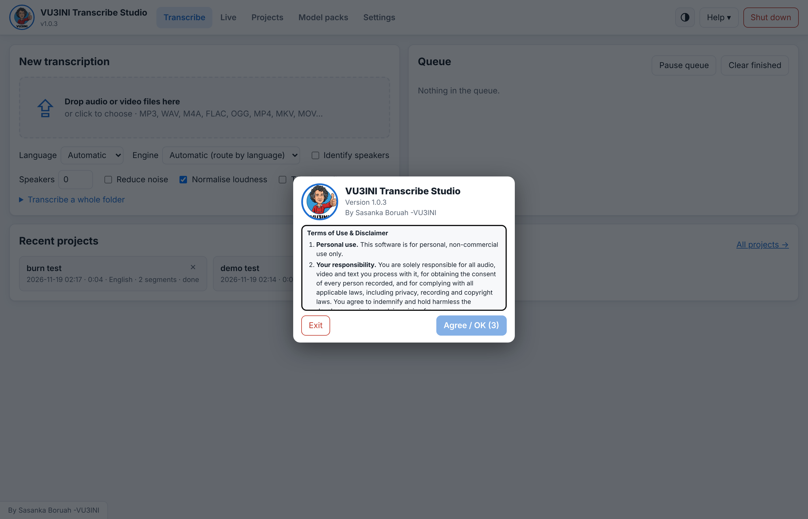

<p align="center">
  
</p>

<h1 align="center">VU3INI Transcribe Studio</h1>

<p align="center">
  Offline, browser-based speech-to-text for <b>Assamese, Hindi, Bengali, English</b> and other Indian languages,<br>
  built on <b>OpenAI Whisper</b>, <b>AI4Bharat IndicWhisper</b> and <b>AI4Bharat IndicTrans2</b>.<br>
  <sub>By Sasanka Boruah -VU3INI · hamvu3ini@gmail.com</sub>
</p>

---

## Why this app

Most transcription tools either send your recordings to a cloud service or handle Indian languages poorly. VU3INI Transcribe Studio runs **entirely on your own Windows PC**: audio, transcripts and models never leave it. It brings together the best open models for Indian languages: OpenAI's multilingual Whisper, AI4Bharat's IndicWhisper language-specific fine-tunes, community fine-tunes such as Assamese Whisper models, and AI4Bharat's IndicTrans2 for translation. All of it sits behind one simple editor that you open in your browser.

It is meant for researchers, archivists, journalists, teachers and anyone who records interviews, meetings, lectures, oral histories or cultural performances and needs an accurate, editable transcript in the original script.



## Features

### Transcription
- **Several engines in one app**:
  - Whisper large-v3-turbo / large-v3 / small, run with faster-whisper (CTranslate2).
  - AI4Bharat IndicWhisper for Hindi and Bengali.
  - Any Hugging Face Whisper fine-tune, for example `anuragshas/whisper-large-v2-as` for Assamese.
  - Other speech models (wav2vec2 etc.) run through transformers.
- **Engine for each language**: a dropdown per language decides which installed model transcribes Assamese, Hindi, Bengali, English and so on. *Automatic* routes each language to the best installed pack.
- **Automatic language detection** and **mixed-language (code-switching)** handling.
- **Word-level timestamps** with a **confidence heatmap** that highlights words the model was unsure about.
- **Speaker diarization** with sherpa-onnx (pyannote segmentation + speaker embeddings): "who spoke when", renameable speakers and talk-time statistics.
- **Custom vocabulary** (names, places, call signs) and **automatic corrections** (`wrong => right`).
- **Hallucination guard** that removes invented lines ("Thank you for watching…") and endless repeats.
- **Audio clean-up** before transcribing: noise reduction, loudness normalisation and silence trimming.
- **Live microphone transcription**: streaming partial results, then the recording is saved as a project.
- **Batch mode** that transcribes a whole folder; your originals are never touched.
- **NVIDIA GPU** acceleration (CUDA 12, float16/int8), with automatic fall-back to the CPU if GPU memory runs out.

### Editor
- Click any word to play from it; the current word and line are highlighted while the audio plays.
- **Waveform** with zoom; drag segment edges to fix timing.
- Split, merge and delete segments; find and replace; playback speed from 0.5× to 2×; keyboard shortcuts.
- **Roman-script view** (transliteration) for readers who don't read the native script.
- **Version history** that restores any earlier save.
- **Translation** with IndicTrans2 (English ↔ Indic, Indic ↔ Indic), shown alongside the original.

### Export
| Format | Notes |
|---|---|
| SRT / WebVTT | Subtitles, optionally with speaker names |
| TXT, CSV, JSON | Plain text, Excel-ready, full data with word timings |
| DOCX | A colour for each speaker |
| PDF | Assamese, Bengali and Devanagari fonts embedded, with correct shaping of conjuncts |
| HTML | One shareable file with the audio built in; click a line to hear it |
| MP4 | Video with **burned-in subtitles**. The text is rendered by the browser, so Indic conjuncts come out correct |

### Model packs, inside the app
Models are **optional packs**, so the installer stays small (about 200 MB). On the **Model packs** tab you tick what you need and click **Download and install**. The app downloads each model, converts it to the fast format and installs it. This is the **only** step that uses the internet, and it runs only when you click the button. You can also keep the `.vtpack` files and install them on an offline PC.



| Pack | Size | Purpose |
|---|---|---|
| Whisper large-v3-turbo | ≈1.6 GB | Main multilingual engine (recommended) |
| Whisper large-v3 / small | ≈3.1 / 0.5 GB | Most accurate / fastest |
| IndicWhisper Hindi, Bengali | ≈1.5 GB each | AI4Bharat single-language models |
| Speaker diarization | ≈40 MB | Identify speakers |
| IndicTrans2 en→indic, indic→en, indic→indic | ≈0.9–1.3 GB | Translation (gated on Hugging Face: needs a free access token) |
| NVIDIA GPU runtime | ≈1.9 GB | cuBLAS + cuDNN so the app can use an RTX card |
| Custom | varies | Any Hugging Face speech model, e.g. an Assamese fine-tune |

> AI4Bharat has not published an IndicWhisper checkpoint for Assamese. Assamese uses Whisper large-v3(-turbo) or a community fine-tune such as [`anuragshas/whisper-large-v2-as`](https://huggingface.co/anuragshas/whisper-large-v2-as).

### Privacy and offline design
- The server listens on `127.0.0.1` only, so other computers can't reach it.
- A built-in **network guard** blocks and logs every outbound connection the app tries to make. Pack downloads run in a separate helper process, and only when you ask for them.
- Every web asset (fonts, scripts, icons) is served locally: no CDN, telemetry, update check or sign-in.
- Projects are stored in `%LOCALAPPDATA%\VU3INI Transcribe Studio`.

### Polish
- A start-up splash with Terms of Use, which you can only accept after 3 seconds.
- A system tray icon with *Open* and *Stop / Exit*.
- Only one copy runs at a time, and **Shut down** stops every background process.
- Dark and light themes (remembered), an offline **searchable user guide** (F1), and an About box listing every bundled component and its licence.

<p align="center"> </p>

## Install (Windows 10/11, 64-bit)

1. Download `VU3INI-Transcribe-Studio-v<version>.zip` from [**Releases**](../../releases) and unzip it.
2. Run `VU3INI-Transcribe-Studio-Setup-v<version>.exe`. It installs for your Windows account only and needs no administrator rights. The installer isn't code-signed, so if SmartScreen appears choose *More info → Run anyway*.
3. Start **VU3INI Transcribe Studio** from the Start Menu or Desktop. Your browser opens the app.
4. Open the **Model packs** tab, tick *Whisper large-v3-turbo* (plus any others you want) and click **Download and install**.
5. Drop an audio or video file onto the **Transcribe** tab.

## How it works

```
Browser UI (HTML/CSS/JS, no frameworks)
   │  HTTP + WebSocket on 127.0.0.1
   ▼
FastAPI server (embedded Python 3.12)
   ├── job queue (one worker, so jobs never compete for the GPU)
   ├── FFmpeg ─ decode / clean-up / playback copy / subtitle overlay
   ├── faster-whisper (CTranslate2) ─ Whisper & IndicWhisper packs
   ├── transformers ─ other Hugging Face speech models, IndicTrans2
   ├── sherpa-onnx ─ speaker diarization
   └── exporters ─ SRT/VTT/TXT/CSV/JSON/DOCX/PDF/HTML
Launcher (tray icon, single instance, Windows Job Object so children die with it)
```

## Repository layout

| Path | Contents |
|---|---|
| `app/server/` | FastAPI back end: engines, diarization, translation, jobs, live streaming, exports, network guard |
| `app/web/` | The browser UI, user guide (`help.json`), fonts and logo |
| `app/launcher/` | Tray launcher (single instance, clean shutdown) |
| `app/tools/make_packs.py` | Downloads and converts models into `.vtpack` packs (used by the app) |
| `packaging/` | Windows build script, NSIS installer scripts, terms, README_FIRST, icon tool |
| `tests/` | Automated test suite (runs with networking disabled) |
| `docs/` | Screenshots |

## Build from source

The build runs on Linux or WSL and produces the Windows installer:

```bash
pip install packaging zstandard pefile
python packaging/build.py             # bumps the version (1.0.3 -> 1.0.4) and builds
python packaging/build.py --no-bump   # rebuilds the current version
```

The script:
1. Fetches Windows Python 3.12 and an LGPL build of FFmpeg from conda-forge, the Windows wheels from PyPI, and NSIS.
2. Checks that every DLL each bundled program needs is present.
3. Stamps the version into the app, the About box and the file names.
4. Writes `build/out/VU3INI-Transcribe-Studio-v<version>.zip`, split into parts with a joining `.bat` and SHA-256 check if it is over 500 MB.

To **replace the logo**, save a square PNG as `app/web/assets/logo-original.png` and run `python packaging/make_icons.py`.

## Tests

```bash
pip install fastapi "uvicorn[standard]" python-multipart faster-whisper sherpa-onnx soundfile python-docx fpdf2 uharfbuzz psutil indic-nlp-library pillow pytest pytest-timeout playwright httpx websockets
unshare -n python tests/run_offline.py -q tests     # Linux: runs with networking disabled
```

The 37 tests start the real launcher and server, build a tiny random Whisper model so the real faster-whisper pipeline runs, and drive the UI in Chrome. They cover:
- offline start-up, with zero external requests;
- installing packs, transcription and every export format;
- editing and version history, search, batch mode, the queue, live streaming and burned-in subtitles;
- the per-language engine choice and the in-app pack downloader;
- the splash (size, 3-second hold, Exit), theme, Help and About;
- single instance and clean shutdown.

**Not yet checked on real Windows:** the tray icon, the installer, GPU decoding on RTX 50-series cards, and accuracy with the real model packs.

## Credits

| Project | Licence |
|---|---|
| [OpenAI Whisper](https://github.com/openai/whisper) | MIT |
| [AI4Bharat IndicWhisper / Vistaar](https://github.com/AI4Bharat/vistaar) | MIT |
| [AI4Bharat IndicTrans2](https://github.com/AI4Bharat/IndicTrans2) | MIT |
| [SYSTRAN faster-whisper](https://github.com/SYSTRAN/faster-whisper) | MIT |
| [k2-fsa sherpa-onnx](https://github.com/k2-fsa/sherpa-onnx) | Apache-2.0 |
| [Indic NLP Library](https://github.com/anoopkunchukuttan/indic_nlp_library) | MIT |
| FFmpeg (LGPL build, conda-forge), Noto fonts (SIL OFL 1.1), FastAPI, PyTorch, transformers and others | see the `licences` folder in the installed app |

Each model pack carries its own licence; check the model card before using a model.

## Terms of use

This software is provided for **personal, non-commercial use**, "AS IS" and without warranty. You are responsible for the recordings you process and for getting the consent of the people recorded. See [`packaging/TERMS.txt`](packaging/TERMS.txt) for the full terms (governed by Indian law; courts at Guwahati, Assam).

---

<p align="center"><sub>Made in Assam by Sasanka Boruah -VU3INI · 73</sub></p>
